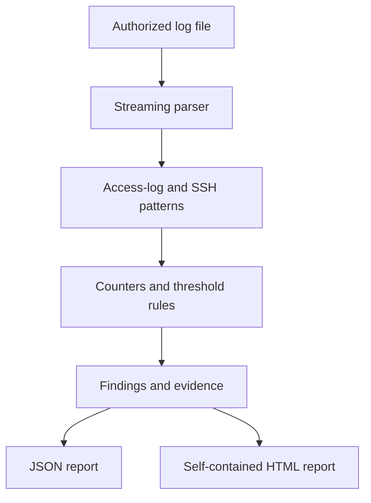

# Log Analyzer & Incident Summary

Streaming log analysis CLI for defensive troubleshooting and incident reporting.

## Capabilities
- Parses common Apache/Nginx access lines and SSH authentication messages
- Processes files line-by-line to avoid loading large logs into memory
- Detects HTTP 5xx spikes, repeated SSH failures, and per-IP request bursts
- Generates JSON or self-contained HTML incident summaries with evidence and recommendations
- Includes synthetic sample logs and tests for malformed/empty input

## Run
```bash
python -m venv .venv
pip install -r requirements.txt
python analyze.py --file sample_logs/access.log --format html --output report.html
python analyze.py --file sample_logs/auth.log --format json --output report.json
pytest -q
```
Only analyze logs you are authorized to access. Detection thresholds are configurable CLI options and should be tuned to the environment.

## Architecture



## Test evidence

Run `pytest -q` from this directory. Tests check the included synthetic access/authentication samples and empty-file handling. CI results are available in the repository's Actions tab; only report a pass after a completed green run.

## Screenshot evidence

Generate the sample HTML report using the command above, open `report.html` in a browser, and capture the summary/findings section. The included logs are synthetic demonstration data, not real incident evidence.
