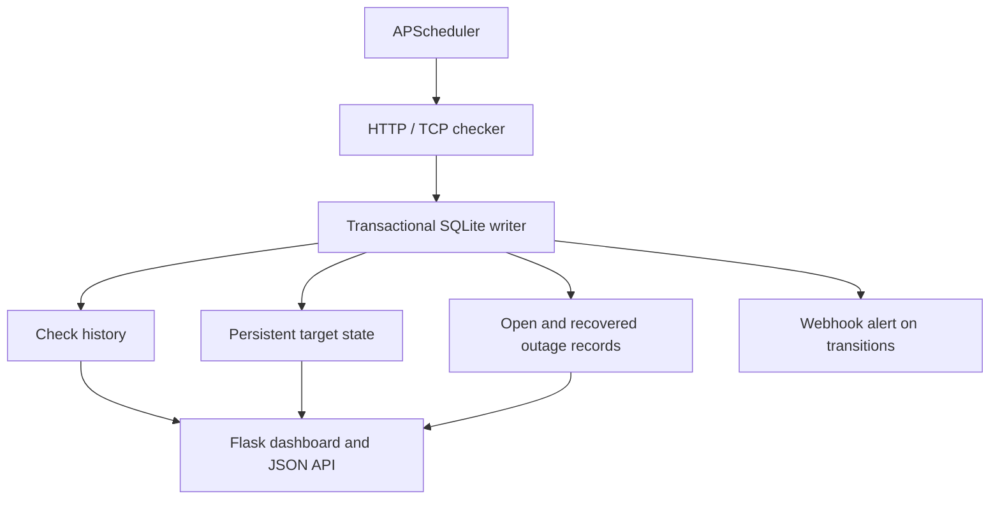

# Network & Uptime Checker

A small service-monitoring backend with a minimal Flask dashboard (the only dashboard in this portfolio).

## Features
- HTTP response/status checks and TCP connection checks
- SQLite history, per-target status and latency
- APScheduler interval checks; configurable targets
- Down state after three consecutive failures and recovery event tracking
- Rolling 24-hour availability calculation and a latency chart
- Webhook alerts via environment variable, Docker Compose, and tests

## Run locally
```bash
python -m venv .venv
pip install -r requirements.txt
python app.py
```
Open `http://127.0.0.1:5000`. Docker: `docker compose up --build`. Add only endpoints and hosts you own or have permission to monitor. ICMP is not enabled by default because it can require OS privileges; HTTP/TCP are supported out of the box.

## Architecture



## Outage and alert semantics

- A target is marked down after the configured number of consecutive failed checks.
- The outage start and down state are persisted in SQLite, so a process restart does not erase an active outage.
- A successful check closes the active outage and creates a recovery transition.
- Webhook delivery is optional. A missing URL or delivery failure is logged; it does not silently count as successful delivery.
- Alert delivery is at-least-attempted, not guaranteed: production deployments should add retries, delivery records, and operational monitoring.

## Test evidence

Run `pytest -q` from this directory. The tests cover outage thresholding, persisted down state after reopening the database, recovery closure, uptime percentage, and simulated webhook success/failure. These are automated tests using a temporary SQLite database and mocked network/webhook calls; they do not prove delivery to a real webhook provider. See GitHub Actions for the latest CI run.

## Screenshot evidence

Start the application with `python app.py`, open `http://127.0.0.1:5000`, and capture the target table and latency chart after at least one check. This README does not claim a runtime screenshot has been captured yet.
