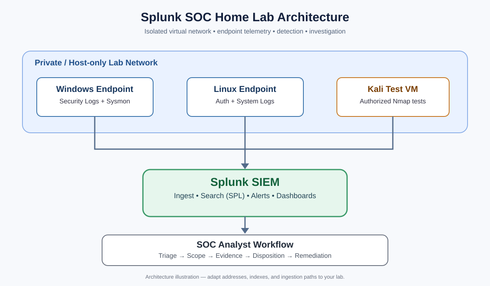
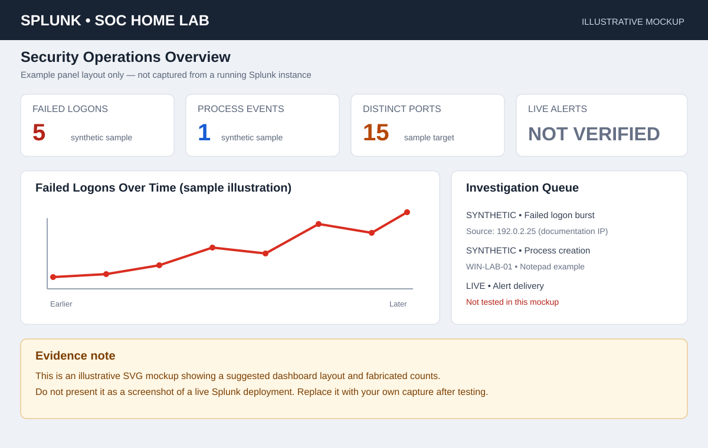

# Splunk SOC Home Lab — End-to-End Detection Engineering

  

An end-to-end, reproducible home-lab project for practicing security telemetry ingestion, SPL investigation, alert logic, dashboard design, and incident reporting.

> **Evidence integrity:** This repository includes sample/synthetic telemetry, repeatable test cases, SPL content, and SVG dashboard mockups. The mockups are illustrative, not screenshots captured from a live Splunk instance. Mark a test as **PASS** only after running it in your own environment and saving genuine screenshots/results under `evidence/live-lab/`.

## Project goals
- Ingest Windows Security, Sysmon, and Linux authentication/system events.
- Investigate repeated failed logons, suspicious process creation, and port-scan-like activity.
- Write and validate SPL searches against known test cases.
- Build dashboards and scheduled alerts.
- Follow a consistent SOC triage workflow and record findings/remediation.

## Architecture

### Components
| Component | Purpose |
|---|---|
| Windows VM | Windows Security logs and a dedicated test account |
| Sysmon | Process creation and selected endpoint telemetry |
| Ubuntu/Debian VM | SSH/authentication and system logs |
| Kali Linux VM | Controlled test host; Nmap only against your isolated lab |
| Splunk lab deployment | Search, alerting, dashboarding and investigation |
| Universal Forwarder / supported ingestion | Forward endpoint logs to Splunk |
| VirtualBox/VMware | Isolated virtual network and snapshots |

Use host-only/internal networking. Do not scan public IPs or systems you do not own or have explicit authorization to test. Use disposable test accounts and never real passwords.

## Repository contents
- `setup/installation-guide.md` — deployment and ingestion walkthrough
- `setup/sysmon-config-notes.md` — Sysmon configuration guidance
- `setup/*inputs.example.conf` — example inputs to adapt, not drop-in universal configurations
- `detections/` — SPL searches and tuning notes
- `dashboards/soc-overview-dashboard.json` — dashboard panel specification
- `simulations/safe-test-procedures.md` — controlled test procedures
- `data/synthetic-events.csv` — fabricated test records
- `tests/test-plan.md` — scenarios and acceptance criteria
- `evidence/synthetic-validation.md` — what the synthetic records are expected to demonstrate
- `evidence/live-lab/README.md` — checklist for genuine screenshots
- `screenshots/` — architecture diagram and clearly labelled dashboard mockup
- `reports/incident-report-template.md` — incident reporting template

## Quick start
1. Read [the installation guide](setup/installation-guide.md).
2. Build an isolated VM network and deploy Splunk.
3. Configure Windows Security auditing, Sysmon, and Linux log forwarding.
4. Confirm real events are searchable before running detections.
5. Review and adapt the SPL searches in [detections](detections/).
6. Run only the controlled tests in [simulations](simulations/safe-test-procedures.md).
7. Validate each detection using [the test plan](tests/test-plan.md).
8. Build the dashboard using [the panel specification](dashboards/soc-overview-dashboard.json).
9. Save timestamped screenshots and actual results using [the live evidence checklist](evidence/live-lab/README.md).

## Detection coverage
| Use case | Primary telemetry | Signal | Analyst action |
|---|---|---|---|
| Repeated failed logons | Windows Security Event ID 4625 | Failures grouped by account/source in a test window | Verify source, target account, and subsequent successful logons |
| Process investigation | Sysmon Event ID 1 | Unexpected process, parent, or command line | Validate user, parent process, path/hash if available, and surrounding events |
| Port-scan-like behavior | Firewall, Zeek, Suricata, or other network logs | One source contacts many distinct destination ports | Confirm target and authorized test window; correlate with endpoint/network events |
| Linux authentication failures | Linux auth logs | Repeated failed SSH/password attempts, if logged | Verify source/account, successful sessions, and exposure |

Exact index, sourcetype, and field names depend on inputs and add-ons. Inspect raw events and adapt each search; do not assume every source has every field.

## Dashboard preview

The dashboard image is a designed mockup with fabricated counts, not a real Splunk screenshot. Build the panels in your running Splunk instance and replace/add genuine captures under `evidence/live-lab/`.

## Evidence and validation
This repository separates:
1. **Synthetic validation:** demonstrates test logic using fabricated records. It does not prove endpoint collection or live alert delivery.
2. **Live-lab validation:** run the tests in your own VM environment and save genuine Splunk search results, event details, alert configuration, and dashboard screenshots.

See [synthetic validation notes](evidence/synthetic-validation.md) and [live evidence instructions](evidence/live-lab/README.md).

## Completion criteria
- [ ] Windows Security events visible in Splunk
- [ ] Sysmon process events visible in Splunk
- [ ] Linux authentication/system events visible in Splunk
- [ ] Failed-logon search validated against controlled test events
- [ ] Process investigation search validated against Sysmon data
- [ ] Port-scan detection validated against available network telemetry
- [ ] At least one alert configured and trigger verified
- [ ] Dashboard built and captured
- [ ] One incident report completed with evidence and remediation
- [ ] Genuine screenshots and test notes added under `evidence/live-lab/`

## Resume wording
Use only bullets that match what you personally completed and validated:

**SOC Home Lab with Splunk SIEM** | Splunk, SPL, Sysmon, Windows, Linux, Kali Linux, Nmap
- Configured Windows, Sysmon, and Linux telemetry collection in Splunk and investigated authentication and endpoint events.
- Developed and tuned SPL searches for repeated failed logons, process execution, and network-scan patterns.
- Built SOC dashboards and documented alert triage, investigation evidence, and remediation recommendations.

## References
- [Splunk Search Reference](https://docs.splunk.com/Documentation/Splunk/latest/SearchReference)
- [Splunk Universal Forwarder documentation](https://docs.splunk.com/Documentation/Forwarder)
- [Microsoft Sysinternals Sysmon](https://learn.microsoft.com/sysinternals/downloads/sysmon)
- [Nmap Reference Guide](https://nmap.org/book/man.html)
