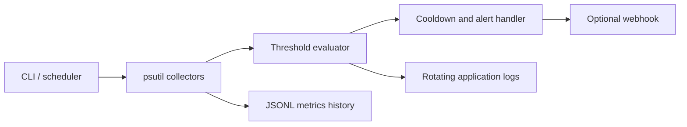

# System Health Monitor

Production-minded local system telemetry and alerting starter.

## Features
- CPU, memory, disk, and top-process snapshots via `psutil`
- YAML thresholds, JSONL metric history, rotating logs
- Alert cooldowns; webhook delivery is optional and secrets stay in environment variables
- One-shot and loop modes; suitable for cron/systemd scheduling
- Unit tests with mocked metrics

## Run
```bash
python -m venv .venv
# Windows: .venv\\Scripts\\activate  | macOS/Linux: source .venv/bin/activate
pip install -r requirements.txt
python monitor.py --once
python monitor.py --interval 60
pytest -q
```
Set `ALERT_WEBHOOK_URL` to enable webhook alerts. Tune `config.yaml` before use. Metrics are written to `data/metrics.jsonl`; logs rotate in `logs/`.

## Operational notes
Run only on systems you administer. Keep webhook URLs private. Thresholds are examples; tune them to reduce noisy alerts.

## Architecture



## Test evidence

Run `pytest -q` from this directory. The tests cover alert cooldown behavior and configuration loading. Do not treat a local test result as verified until you have run the command and captured its output. CI results are available under the repository's Actions tab.

## Screenshot evidence

Capture a terminal screenshot after running `python monitor.py --once`, showing the metrics collection message and the generated `data/metrics.jsonl` file. Do not use fabricated metrics as production evidence.
