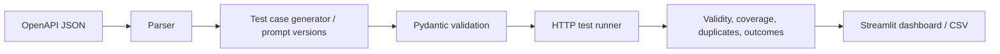

# AI-Assisted API Test Generator

A tool that reads an OpenAPI document, creates structured API test-case specifications, executes safe generated cases against a target service and measures specification coverage. The baseline generator is deterministic; an LLM adapter can be added and benchmarked without making tests dependent on an external provider.

## Architecture


## Quick start
```bash
python -m venv .venv
pip install -r requirements.txt
python -m src.cli --spec specs/device-openapi.json --output reports/generated.json
pytest -q
```

## Metrics
- Validity rate: generated records that pass the Pydantic contract.
- Executability rate: valid records accepted by the runner and completed.
- Spec coverage: unique operation IDs covered / operations in the spec.
- Duplicate rate: duplicate normalized test cases / generated cases.
- Mutation score: mutants detected / non-equivalent mutants executed.

## Milestones
- [x] OpenAPI path/method parser and typed test-case model
- [x] Deterministic baseline generator and coverage evaluator
- [ ] LLM JSON generation with repair/retry and prompt versions v1/v2
- [ ] Safe runner with isolated test environment and execution allowlist
- [ ] 5–8 controlled API mutants and mutation score
- [ ] DeepEval GEval review of relevance and clarity
- [ ] Streamlit dashboard, pytest export and prompt/model comparison

## Safety
Only execute generated requests against an explicitly configured local or authorized test host. The runner must enforce an allowlist, block arbitrary hosts and avoid destructive operations unless the target is disposable.
