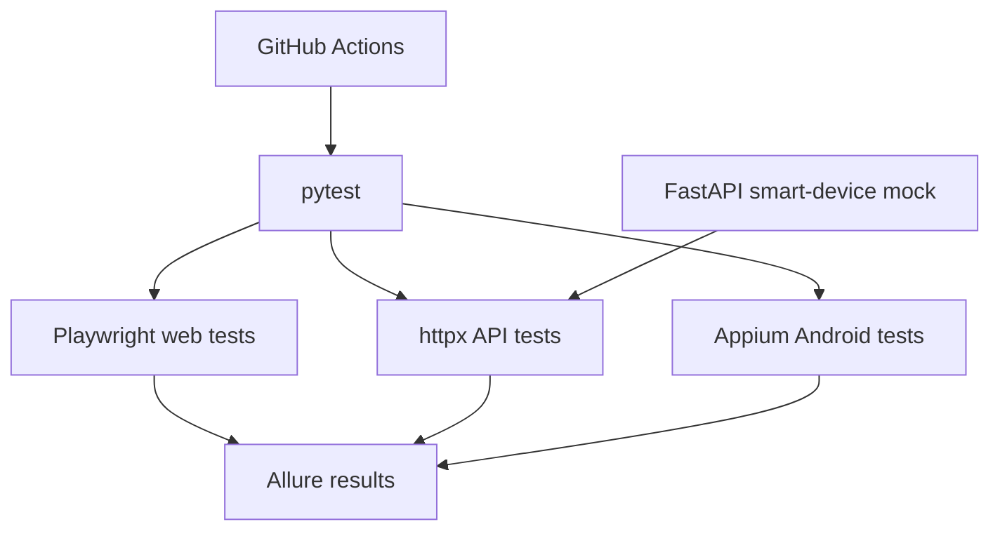

# Web + Mobile + API Test Automation Framework

A Python/pytest portfolio framework that tests browser workflows, REST endpoints and an Android sample application. Includes a smart-device mock API to model a connected fan.

## Architecture


## Stack
Python 3.11+, pytest, Playwright, httpx, FastAPI, Pydantic, Appium 2 / UiAutomator2, Allure, Docker and GitHub Actions.

## Quick start
```bash
python -m venv .venv
pip install -r requirements.txt
playwright install chromium
uvicorn mock_backend.app:app --reload
pytest -m "api or smoke" -q
```

## Test scope
- API: authentication, CRUD, invalid token, invalid speed, missing fields, schema and boundary checks.
- Web: SauceDemo login, inventory, cart and checkout using Page Object Model. Use only the public demo target and respect its terms.
- Mobile: Appium sample app tests for launch, navigation, text entry, scrolling and gestures; run locally with Android Studio emulator and UiAutomator2.
- Reporting: Allure results, failure screenshots and traces. CI runs API tests; mobile emulator execution is documented as a local step.

## Milestones
- [x] Smart device API and API test baseline
- [ ] 40+ API tests and Postman/Newman collection
- [ ] Playwright POM suite, cross-browser checks and failure artifacts
- [ ] Selenium comparison smoke tests
- [ ] Appium screen objects and 10–15 emulator tests
- [ ] Allure report, xdist, Docker and CI artifacts

## Evidence and integrity
Save actual test output, screenshots, Allure report and CI links under `docs/evidence/`. Record environment and browser versions. Do not inflate test counts or report unrun mobile tests as passing.
