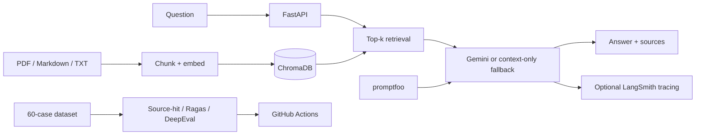

# RAG Chatbot + LLM Evaluation Pipeline

A retrieval-augmented product-support chatbot over sample ceiling-fan documentation, with PDF/Markdown/text ingestion, ChromaDB, sentence-transformer embeddings, FastAPI, optional Gemini generation, Streamlit and reproducible evaluation scripts.

## Architecture


## Setup
```bash
python -m venv .venv
# Windows: .venv\\Scripts\\activate
# macOS/Linux: source .venv/bin/activate
pip install -r requirements.txt
# Optional Gemini key in .env
python -m src.ingest
uvicorn src.api:app --reload
```
Open `http://127.0.0.1:8000/docs`; in another terminal run `streamlit run app/dashboard.py`. Without a Gemini key, answers are retrieved context excerpts, not LLM-generated responses.

## Dataset review and deterministic evaluation
```bash
python -m evals.review_dataset
python -m evals.evaluate
```
The 60 questions were reviewed against the two supplied sample documents and rewritten to remove templated duplicates. The script checks case count, unique IDs/questions, cited source files and category labels. The review is assistant-performed; human sign-off is still pending. The deterministic baseline reports source-file hit rate, not answer correctness or semantic faithfulness.

## LLM-as-judge evaluation
Set `GEMINI_API_KEY` in the environment before running:
```bash
pip install -r requirements-eval.txt
python -m evals.run_ragas --limit 60
python -m evals.run_deepeval --limit 60
``
Ragas evaluates faithfulness, context precision, context recall and answer relevancy. DeepEval evaluates answer relevancy, faithfulness and a custom GEval quality rubric. These runs incur Gemini API usage. No score should be claimed until the commands complete and their reports are inspected.

## CI evidence
The root workflow `.github/workflows/ai-quality-engineer.yml` runs the dataset review, API tests and deterministic source-hit baseline, and uploads the reports. Gemini-based Ragas/DeepEval jobs run only when the repository secret `GEMINI_API_KEY` is configured. Configure it under GitHub Settings → Secrets and variables → Actions. Android tests and API mutation tests run in their own CI jobs.

## Limitations
The sample documents are intentionally small and are not real product instructions. The 60-case set covers 20 source-grounded intents with three distinct phrasings each; it is not 60 independent knowledge facts. Human benchmark review remains required before publishing external quality claims.
