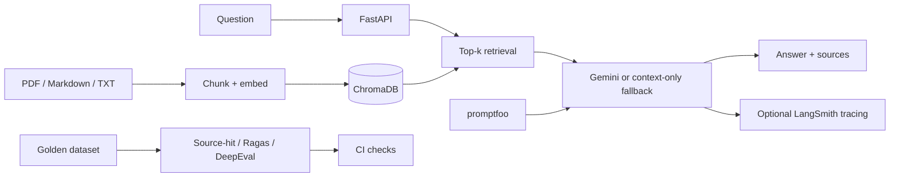

# RAG Chatbot + LLM Evaluation Pipeline

A retrieval-augmented product-support chatbot over sample ceiling-fan documentation, with PDF/Markdown/text ingestion, persistent ChromaDB, local sentence-transformer embeddings, optional Gemini generation, FastAPI, Streamlit, a 60-case draft evaluation set and optional quality-tool integrations.

## Architecture


## Setup
```bash
python -m venv .venv
# Windows: .venv\\Scripts\\activate
# macOS/Linux: source .venv/bin/activate
pip install -r requirements.txt
# Copy .env.example to .env and set GEMINI_API_KEY if desired
python -m src.ingest
uvicorn src.api:app --reload
```
Open `http://127.0.0.1:8000/docs`. In another terminal run `streamlit run app/dashboard.py`. Without a Gemini key, the system returns retrieved context excerpts rather than generating a model answer.

## Evaluation
- `pytest -q tests`: deterministic API and chunking checks.
- `python -m evals.evaluate`: writes a source-hit CSV from the 60-case draft dataset.
- `pip install -r requirements-eval.txt`: installs optional Ragas/DeepEval/LangSmith packages.
- `python -m evals.run_ragas --limit 10`: Gemini-judged faithfulness, context precision/recall and answer relevancy; use `--limit 0` for all cases.
- `python -m evals.run_deepeval --limit 10`: Gemini-judged DeepEval answer relevancy, faithfulness and custom GEval; review actual scores and judge reasons.
- `npx promptfoo eval -c evals/promptfooconfig.yaml`: prompt-level assertions (requires promptfoo and Gemini credentials).

## Important limitations
The 60 golden cases are generated draft cases and require human review before being called a validated benchmark. The CSV runner measures source-hit only; it does not yet produce Ragas faithfulness/context metrics or DeepEval judge scores. LLM judge evaluation needs explicit model configuration, cost controls and human spot-checking. LangSmith tracing is opt-in and requires environment configuration. No quality percentages are claimed until reproducible reports are generated.
