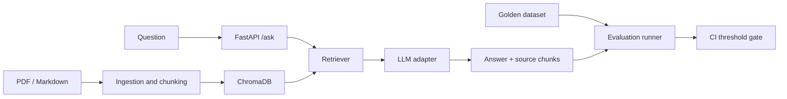

# RAG Chatbot + LLM Evaluation Pipeline

A testable Retrieval-Augmented Generation (RAG) reference application with document ingestion, retrieval, an API, a golden evaluation dataset, adversarial cases and a CI quality gate.

## Architecture

## Stack
Python 3.11+, FastAPI, ChromaDB, sentence-transformers, pytest, Ragas/DeepEval integration points, promptfoo, optional LangSmith tracing.

## Quick start
1. Create an environment: `python -m venv .venv`
2. Activate it and install: `pip install -r requirements.txt`
3. Copy `.env.example` to `.env` and configure a provider only if using live generation.
4. Run API: `uvicorn src.api:app --reload`
5. Run tests: `pytest -q`

The default adapter is deterministic and local so tests do not require paid API access. Replace it with a provider adapter for live LLM experiments. Never commit credentials.

## Evaluation
- Add question, reference answer and expected source IDs to `data/golden_dataset.json`.
- Evaluate faithfulness, answer relevancy, context precision and context recall when an LLM judge/provider is configured.
- Run adversarial inputs from `evals/redteam_cases.json`.
- CI runs deterministic tests and the quality gate. Configure real evaluation scores only after collecting reproducible results.

## Project milestones
- [x] API skeleton, local baseline, data contracts and deterministic tests
- [ ] PDF/Markdown ingestion and persistent vector indexing
- [ ] 60–100 reviewed golden Q/A cases
- [ ] Ragas and DeepEval metrics with documented judge/model settings
- [ ] promptfoo model/prompt comparison and LangSmith traces
- [ ] 20+ red-team cases and CI regression threshold
- [ ] Record real before/after results and demo

## Evidence
Store sanitized screenshots, evaluation CSV/HTML, CI runs and a short demo under `docs/evidence/`. Do not claim metrics until the run artifacts support them.

## Limitations
LLM-as-judge scores are estimates and can be biased or variable. Use human review, fixed evaluation sets and explicit thresholds. The local baseline is for engineering tests, not a substitute for a production LLM.
